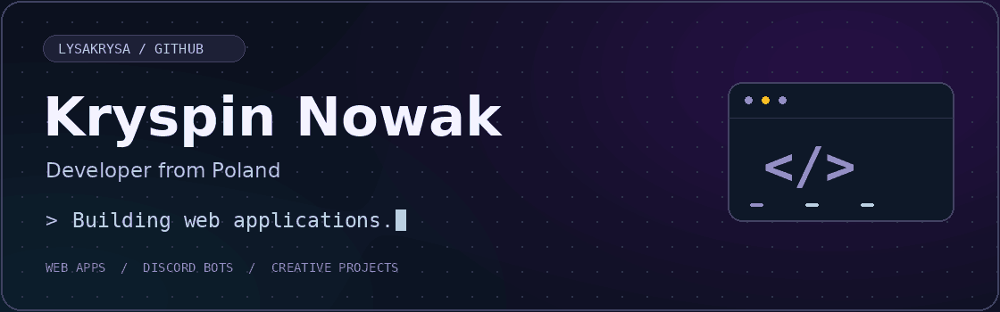
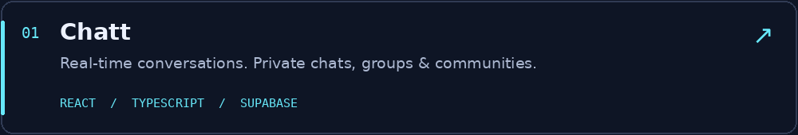
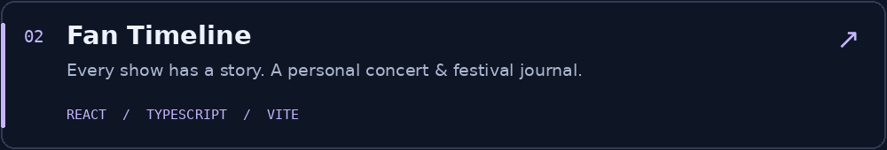
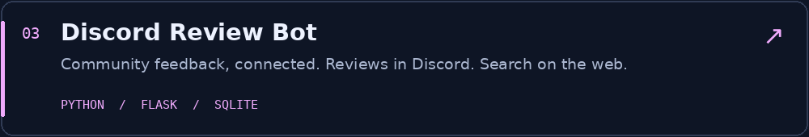

 

  

### Hey, I'm Kryspin 👋

You might know me as **LysaKrysa**. I'm a developer from **Poland 🇵🇱** 
building web apps, Discord bots, and creative side projects.

JavaScript, TypeScript, and Python are at the heart of what I build. 
Outside the web, my toolbox also includes Blender, Arduino, and Raspberry Pi.

 

### 🧰 My toolbox

<strong>Code & web</strong>

<strong>Data & development</strong>

<strong>Design & tinkering</strong>

  

### ✨ A few things I've built

**[More projects on my GitHub →](https://github.com/LysaKrysa?tab=repositories&type=public)**

 

### Let's connect

Questions about my code, bots, or projects? 
Say hello on [Discord](https://discord.com/users/1010135761322000434) or send me an [email](mailto:noobgokf@gmail.com).

 

Thanks for stopping by · Kryspin / LysaKrysa

